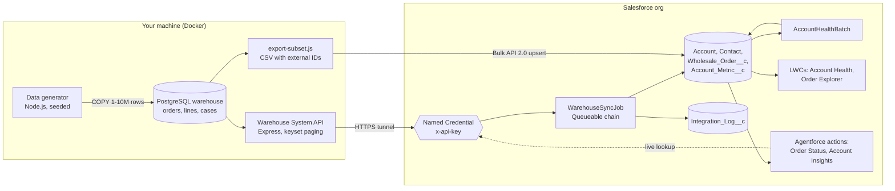

# Laheey Wholesale Ops

**A Salesforce developer portfolio project built on 1 to 10 million rows of realistic business data.**

Laheey Coffee Roasters sells Ethiopian and single-origin coffee to two kinds of buyers: wholesale clients (cafes, grocers, offices, restaurants, hotels and universities) and direct customers on its Shopify store. Orders, customers and support cases live in a PostgreSQL warehouse. Sales and operations staff work in Salesforce.

This project connects the two the way real companies do. The full history stays in the warehouse. Salesforce receives the slice people act on: the top accounts, recent orders, monthly metrics and a health score. Agentforce answers "where is my order?" and "how is this account doing?" from either side.

> All data is synthetic, generated from a fixed seed. Names are invented, emails use `example.com` and phone numbers use the reserved 555-01xx range.

| | |
|---|---|
| **Data** | 1.0M rows (scale `s`, 28 s to load), 3.0M (`m`) or 10.0M (`l`, 4 min, 1.4 GB). Measured on a cloud dev box; expect 2–3x on a laptop. |
| **Warehouse** | PostgreSQL 16 in Docker: 7 tables, foreign keys, unique external-ID indexes, 9 query indexes, 3 materialized views |
| **API** | Node/Express "System API" with keyset pagination and API-key auth; 5 integration tests |
| **Salesforce** | 4 custom objects plus Account and Contact, 46 custom fields, 2 triggers, Queueable + Schedulable + Batch Apex, 2 LWCs, 2 Agentforce actions, 22 Apex test methods |
| **Ops** | Bulk API 2.0 loads, Named Credential callouts, Integration Log object, GitHub Actions CI |

## Architecture



Two ways data reaches Salesforce, on purpose:

- **Push (Level 6):** export the slice as CSV and upsert it with Bulk API 2.0. No network setup. Good for first loads.
- **Pull (Level 4):** Salesforce calls the API on a schedule through a Named Credential. This is the production pattern: idempotent, logged, retryable.

## Progressive skill levels

Each level adds one layer and maps to a week of the study roadmap. Full walkthroughs: [docs/LEVELS.md](docs/LEVELS.md).

| Level | You build | Skills it proves | Roadmap weeks |
|---|---|---|---|
| 1 | Data model, external IDs, security | Objects, master-detail, permission sets, OWD | 1 |
| 2 | Validation rule + record-triggered Flow | Declarative-first automation | 2 |
| 3 | Order triggers, rollup, test classes | Bulkification, handler pattern, 85%+ coverage | 3–6 |
| 4 | Warehouse sync over a Named Credential | Callouts, Queueable chaining, Schedulable, idempotent upserts | 7 |
| 5 | Account Health card, Order Explorer | LWC, `@wire`, imperative Apex, infinite scroll | 8–9 |
| 6 | 10M-row warehouse, Bulk API loads, Batch Apex | Large data volumes: selectivity, keyset paging, aggregates, skew | 10–12 |
| 7 | Agentforce assistant with Apex actions | Invocable actions, agent instructions, Prompt Builder, testing | 13–16 |
| 8 | CI, scratch orgs, the demo | DevOps, documentation, presenting technical work | 17–18 |

## Quick start

```bash
npm install
cp .env.example .env                 # set API_KEY
docker compose up -d db
npm run generate:s                   # 1M rows; or generate:m (3M) / generate:l (10M)
docker compose up -d api
curl -H "x-api-key: $(grep API_KEY .env | cut -d= -f2)" localhost:8080/v1/stats

cd salesforce
sf org login web --alias laheey --set-default
sf project deploy start
sf org assign permset --name Laheey_Wholesale_Ops --name Laheey_Integration
sf apex run test --test-level RunLocalTests --code-coverage --result-format human --wait 20

cd .. && npm run export:subset -- --profile dev-edition
scripts/load-salesforce.sh laheey
```

Full instructions, including the Named Credential and tunnel for the pull sync: [docs/SETUP.md](docs/SETUP.md).

## Repository map

```
generator/      Seeded data generator (1M / 3M / 10M rows) and its tests
warehouse/      schema.sql, post_load.sql (keys, indexes, views), walkthrough.sql (LDV exercises)
api/            Express System API, Dockerfile, integration tests
scripts/        export-subset.js, load-salesforce.sh, anonymous Apex in scripts/apex/
salesforce/     Salesforce DX project: objects, triggers, classes, LWCs, permission sets
docs/           Setup, architecture, data model, levels, LDV, agent design, demo script, troubleshooting
.github/        CI: generator + API tests against Postgres; optional scratch-org deploy and Apex tests
```

## Documentation

- [SETUP.md](docs/SETUP.md): install, generate, deploy, load, connect
- [ARCHITECTURE.md](docs/ARCHITECTURE.md): components, data flow, design decisions and trade-offs
- [DATA_MODEL.md](docs/DATA_MODEL.md): warehouse tables, Salesforce objects, the mapping between them
- [LEVELS.md](docs/LEVELS.md): the eight progressive levels, step by step
- [LARGE_DATA_VOLUMES.md](docs/LARGE_DATA_VOLUMES.md): measured query timings and the Salesforce LDV concepts behind them
- [AGENT_DESIGN.md](docs/AGENT_DESIGN.md): the Agentforce assistant: subagents, actions, guardrails, tests
- [DEMO_SCRIPT.md](docs/DEMO_SCRIPT.md): a 10-minute walkthrough for interviews, plus likely questions
- [TROUBLESHOOTING.md](docs/TROUBLESHOOTING.md)

## Status

- Generator, warehouse, API: tested end to end on PostgreSQL 16 at 1M and 10M rows (10 automated tests passing).
- Salesforce project: converts cleanly with the Salesforce CLI; all 22 Apex files pass a syntax check; LWC JavaScript parses. It has not yet been deployed to an org: deploying it is Level 1, and the first deploy may surface a compile error to fix, which is normal and good practice.

## License

MIT. Built by Eyasu Gebrehiwot as a learning and portfolio project.
